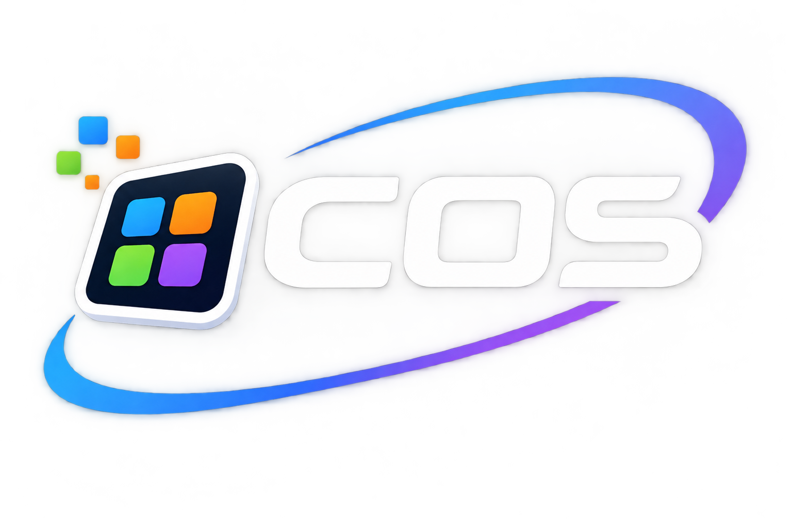

# COS

COS is a firmware project for the ESP32-based CYD board (ESP32-2432S028R), featuring an ILI9341 display with XPT2046 resistive touch.

## Prerequisites

### ESP-IDF

Install [ESP-IDF v6.1](https://docs.espressif.com/projects/esp-idf/en/v6.1/esp32/get-started/index.html), the version used by CI.

### Environment variables

Set `IDF_PATH` to the ESP-IDF v6.1 checkout. `IDF_TOOLS_PATH` and
`IDF_PYTHON_ENV_PATH` are optional overrides for the tool and Python
environments:

| Variable              | Example (Windows)                     | Example (Linux / devcontainer)          |
| --------------------- | ------------------------------------- | --------------------------------------- |
| `IDF_PATH`            | `C:\esp\v6.1\esp-idf\`                | `/opt/esp/idf`                          |
| `IDF_TOOLS_PATH`      | `C:\Espressif\tools`                  | `/opt/esp`                              |
| `IDF_PYTHON_ENV_PATH` | `C:\Espressif\tools\python\v6.1\venv` | `/opt/esp/python_env/idf6.1_py3.12_env` |

**Windows (CMD):**

```cmd
set ESP_IDF_VERSION=6.1
set IDF_PATH=C:/esp/v6.1/esp-idf/
set IDF_TOOLS_PATH=C:/Espressif/tools
set IDF_PYTHON_ENV_PATH=C:/Espressif/tools/python/v6.1/venv
```

**Windows (PowerShell):**

```powershell
$env:ESP_IDF_VERSION = "6.1"
$env:IDF_PATH = "C:/esp/v6.1/esp-idf/"
$env:IDF_TOOLS_PATH = "C:/Espressif/tools"
$env:IDF_PYTHON_ENV_PATH = "C:/Espressif/tools/python/v6.1/venv"
```

**Linux / macOS:**

```bash
export ESP_IDF_VERSION=6.1
export IDF_PATH=~/.espressif/v6.1/esp-idf
export IDF_TOOLS_PATH=~/.espressif/tools
export IDF_PYTHON_ENV_PATH=~/.espressif/python_env/idf6.1_py3.12_env
```

### Host tools

| Tool         | Purpose                                      | Install                                                                                  |
| ------------ | -------------------------------------------- | ---------------------------------------------------------------------------------------- |
| GNU Make     | Build orchestration                          | Included with MSYS2 / Xcode CLT / apt                                                    |
| CMake        | Test build system                            | Bundled with ESP-IDF (`C:\Espressif\tools\cmake`)                                        |
| GCC (host)   | Compile host-based unit tests                | `winget install BrechtSanders.WinLibs.POSIX.UCRT` (Windows) or `apt install gcc` (Linux) |
| Python 3     | Tidy-script tests and QEMU integration tests | Bundled with ESP-IDF or `python3` on Linux                                               |
| clang-format | Code formatting                              | Bundled with LLVM or ESP-IDF clang toolchain                                             |
| clang-tidy   | Static analysis                              | Bundled with LLVM or ESP-IDF clang toolchain                                             |

Host unit tests require CMake, Ninja, a host C compiler, and Python 3. QEMU
integration tests additionally require ESP-IDF v6.1, its QEMU tool, and the
pinned Python test plugins in `integration_test/requirements.txt`. Activate
the ESP-IDF environment before installing the plugins:

```bash
python -m pip install -r integration_test/requirements.txt
python "$IDF_PATH/tools/idf_tools.py" install qemu-xtensa
```

## Build and flash

```bash
make build       # compile the firmware
make flash       # flash to the connected board
make flash-data  # build and upload data to the flash storage (LittleFS) only
make monitor     # open serial monitor (115200 baud)
```

`make flash-data` packages `storage/flash_data` as a LittleFS image and flashes only the `littlefs` partition; it does not flash firmware or erase other partitions. It leaves the board in the bootloader after transfer; press the board's reset button to boot COS. To select a serial port, use `make flash-game PORT=COM5` (replace with your port). After flashing, start either Berry game from the COS console:

```text
berry run /flash/apps/breakout.be
```

Drag your finger across the screen to move the Breakout paddle. Tap **RESET** to restart or **EXIT** to return to the console. The Tap Dash example is also available with `berry run /flash/apps/tap_dash.be`.

## Console

Once flashed, the firmware starts an interactive console on UART (`cos>` prompt). Available commands:

| Command                           | Description                                               |
| --------------------------------- | --------------------------------------------------------- |
| `clear`                           | Clear the text console                                    |
| `alias` / `unalias`               | List, define, or remove persistent command aliases        |
| `calibrate`                       | Run interactive touch screen calibration                  |
| `cd`, `pwd`                       | Change or show the current directory                      |
| `ls`, `dir`                       | List directory contents                                   |
| `mkdir`, `md`                     | Create a directory                                        |
| `rm`, `del`                       | Remove a file or empty directory                          |
| `cp`, `mv`, `rmdir`               | Copy, move, or remove files/directories                   |
| `cat`, `type`, `touch`, `hexdump` | Read, create, or inspect files                            |
| `sd`                              | Mount, unmount, or inspect the SD card                    |
| `info`, `format`                  | Show filesystem usage or format flash                     |
| `display_mode`                    | Inspect or clear the display                              |
| `wifi`                            | Show Wi-Fi status, scan, and connect or disconnect        |
| `bt`                              | Show Bluetooth status and manage device connections       |
| `led`, `light`, `screen`          | Inspect or control the LED, light sensor, and brightness  |
| `i2c`                             | Scan the bus and read or write device data                |
| `time`                            | Show local/UTC time, sync status, or epoch                |
| `server`, `ws`                    | Inspect and control the HTTP server and WebSocket clients |
| `restart`, `uptime`               | Restart the device or show uptime                         |
| `ping <host> [timeout_ms]`        | Resolve a host and send one ICMP echo request             |
| `nslookup <host> [timeout_ms]`    | Resolve a hostname to IPv4                                |
| `berry run <path> [args...]`      | Execute a Berry entrypoint script from `/flash`/`/sdcard`     |
| `berry eval <source>`             | Evaluate Berry source in the shared VM                    |
| `berry close`                     | Close the active Berry app and run its teardown method    |
| `mem` / `memory`                  | Show current, minimum, and largest free heap metrics      |
| `logging [error\|warn\|info]`     | Set the persistent global ESP log threshold               |
| `help`                            | List all registered commands                              |

File commands accept virtual paths and resolve relative paths from the current
directory. `cp <source> <destination>` and `mv <source> <destination>` operate
on regular files and refuse to overwrite an existing destination; directory
copy and move are not supported. Copies use bounded memory. A move within one
filesystem uses rename; a move between flash and SD copies the file and removes
the source only after the copy succeeds. `rmdir <directory>` removes an empty
directory; `rm` also retains its existing support for removing empty
directories. Press **Tab** at the end of a command or supported path argument
to complete a unique match or extend an ambiguous match to its common prefix.
Paths containing whitespace are not completed.
The line editor accepts up to 127 characters plus its terminator and retains
eight history entries. Its line, history, saved-line, and Berry prompt buffers
use 1,408 bytes of static RAM; the existing limits are retained.

Define a persistent alias with `alias <name> <command>`, list aliases with
`alias`, and remove one with `unalias <name>`. Quote a command and its fixed
arguments when defining it, for example
`alias breakout "berry run apps/breakout.be"`. Aliases map to a registered
command, may include fixed arguments, and pass through arguments supplied at
use; they do not shadow existing commands or chain to other aliases. Up to
eight aliases are stored in `/flash/.cos_aliases`.
Aliases expand on interactive shell command lines; Berry `action()` calls
continue to invoke registered commands directly.

When the text console owns the display, drag downward to view older output and
upward to return toward live output. The console lazily allocates scrollback,
retains up to 128 rows in addition to the visible grid, and discards the oldest
rows when full. `display_mode clear` releases that history; it is also released
when a Berry app starts. Output continues over UART while a Berry app owns the
display, but is not retained in console history.

The global ESP log threshold defaults to `warn`. Use `logging` to show the
current setting, or `logging error`, `logging warn`, and `logging info` to
change it; the selection persists across reboots and affects UART and console
logs. Use `mem` for current free heap, minimum free heap since boot, total
heap, and largest allocatable block. Berry app startup also logs heap snapshots
at INFO level; set `logging info` to see them.

`ping` sends one ICMP echo request; `nslookup` performs DNS resolution only.
Both accept an optional 100–3000 ms overall deadline (default 1000 ms), which
includes DNS resolution, and require Wi-Fi station connectivity. They use the
same serialized worker as Berry `net.ping`; if DNS continues after a caller
times out, another request is rejected until the lookup finishes.

Berry scripts use COS virtual paths. For example, `berry run /flash/apps/demo.be` runs a flash script, and `berry run /sdcard/apps/demo.be` runs one from an inserted SD card. Relative paths are resolved from the shell's current directory.

`berry run <path> [args...]` executes the script's top-level code, then resolves its entrypoint:
- **Command script:** set global `__cos_entry` to an instance with `run(args)`, or define a global `run(args)` function. The runtime calls `run(args)` with a Berry list of strings (excluding the script path) and returns its integer shell status (`nil` means `0`). Execution is non-intrusive (it does not close an active UI app).
- **UI app:** set global `__cos_entry` to a class or instance with `setup(content, width, height)`. The runtime launches it (closes/replaces the active UI app, hides the console, constructs the class if needed, calls `setup(0, display_width, display_height)`, and starts the UI). A successful launch returns status `0`.

The bundled `/flash/scripts/arg_test.be` demonstrates argument handling:

```text
berry run scripts/arg_test.be "argument 1" "asd asd asd argument 2"
```

It prints:

```text
1: argument 1
2: asd asd asd argument 2
```

Use `berry eval 'print(1 + 2)'` for a short expression. The runtime exposes `log(message)` and `action(command)`; `action` runs a registered COS console command and returns its integer command status or an ESP error name, not parsed command output.

If `/flash/autoexec.be` exists, COS runs it once during shell startup after the
filesystem and Berry runtime are ready. A missing file is ignored; script or
runtime errors are logged and do not prevent the shell from starting. The
LittleFS examples include an autoexec that clears the console and
`/flash/scripts/clear.be`, which demonstrates clearing it from a Berry script
with `action("clear")`. Autoexec runs during startup, not on the console input
task, so it should not start `console.read_line()`.

The Berry interpreter is fetched from a fixed upstream commit during CMake configuration. Python 3 is required to generate Berry's constant tables during the build.

The Berry runtime also provides:

| API                                   | Behavior                                                                                                                                                                                                                                                                                                                                  |
| ------------------------------------- | ----------------------------------------------------------------------------------------------------------------------------------------------------------------------------------------------------------------------------------------------------------------------------------------------------------------------------------------- |
| `console.read_line(prompt, callback)` | Start a non-blocking console prompt. The callback receives the entered string, or `nil` after Ctrl+C. It returns `true` when the request starts or an ESP error name on failure.                                                                                                                                                          |
| `console.cancel_input()`              | Cancel the pending prompt; the callback receives `nil`. Returns `true` when cancellation is accepted, `false` if none is pending, or an ESP error name. Cancellation from another task is handed to the console input task.                                                                                                               |
| `fs.list(path)`                       | List up to 64 entries from an absolute `/`, `/flash`, or `/sdcard` virtual path. Returns `{ok, entries, count}` or `{ok, error}`; entries contain `name`, `size`, `is_dir`, `mtime`, and `ctime`. Traversal segments are rejected.                                                                                                                 |
| `net.ping(host, timeout_ms=1000)`     | Resolve an IPv4 host and send one ICMP echo request. Returns `{ok, host, address, rtt_ms, error}` by the 100–3000 ms caller deadline, including DNS time. DNS and ICMP run on one serialized worker; if DNS outlives the caller, a later ping is rejected until the worker finishes the configured lwIP retries. Wi-Fi must be connected. |

Small Berry starter scripts are included in `/flash/scripts`: run
`berry run /flash/scripts/hello.be`, `list_files.be`, `ping.be`, or `prompt.be`.
The prompt example uses asynchronous input and returns control to the shell
input loop while it waits for a response.

Berry maps are accessed with indexing, for example `listing["ok"]` and
`listing["entries"][0]["name"]`.

`console.read_line` must be started by code running on the console input task (for example, a script launched with `berry run`, or an app's `setup`). While the prompt is active, it owns keyboard input even if a Berry UI app is visible. UI callbacks can cancel the request, but cannot start a second prompt directly.

Berry entrypoints are exposed via the global `__cos_entry` (or, for simple command scripts, a global `run(args)` function). UI apps set `__cos_entry` to a class or instance with `setup(content, width, height)`; the runtime launches them and `ui.launch(app)` remains available for explicit launches from Berry code (it performs the app lifecycle: replace the active app as needed, instantiate a class when passed, call `setup(0, display_width, display_height)`, and start the UI). Command apps set `__cos_entry` to an instance with `run(args)` (or define `run(args)` directly). `berry close` invokes the optional `teardown()` method and cancels any pending console prompt. TypeScript COS sources keep the `export default class ... implements CosApplication/CosUiApplication` pattern; the compiler lowers them to `__cos_entry`. The Berry `ui` module currently supports labels, buttons, group boxes, checkboxes, bounds, text updates/colors, click/change handlers, timers, random values, deferred app exit/explicit launch, and clearing containers. Other cyd-proto widgets and the desktop/window framework are still migration work in progress.

While a Berry UI app is active, its UI owns the display and the text-console renderer is paused to prevent the console and UI from drawing over each other. The UI redraws only when its content changes, and console output continues over UART and is rendered on screen again after `berry close` or `ui.exit()`. Berry game apps can also use `ui.fill_screen`, `ui.fill_rect`, and `ui.draw_text` for direct display drawing, plus `ui.touch()` to read the current touch position. `ui.key_down(keycode)` polls held keys from a Bluetooth HID keyboard; keycodes are USB HID usages, with constants including `ui.KEY_LEFT`, `ui.KEY_RIGHT`, `ui.KEY_A`, and `ui.KEY_D`. Use `ui.start_write()` and `ui.end_write()` to batch related display operations into one write transaction.

Breakout supports both touch-drag paddle control and Bluetooth keyboard controls (left/right arrows or A/D); touch remains available and either input method can be used during play.

## Documentation

Project docs are organized by status under [`docs/`](./docs/README.md):

- [`docs/plan/consolidated-improvement-plan.md`](./docs/plan/consolidated-improvement-plan.md) — **living tracker** for planned/remaining work, priorities, and validation evidence.
- [`docs/history/`](./docs/history/) — historical design specs and improvement records (detailed background).
- [`docs/ideas/`](./docs/ideas/) — draft proposals not yet committed to the main plan.
- [`docs/reports/`](./docs/reports/) — hardware validation, profiling, audits, and focused evidence.

API/code documentation can be checked with `make docs-check` (Doxygen).

## Development

```bash
make format       # auto-format all source files
make format-check # check formatting (CI-friendly, fails on violations)
make lint         # run clang-tidy static analysis
make test         # build and run host-based unit tests
make integration-test       # build and run all discovered QEMU integration tests
make integration-test-build # build all integration-test firmware projects
make integration-test-run   # run all integration tests (after building)
make docs-check   # validate Doxygen documentation
make menuconfig   # open ESP-IDF configuration menu
make clean        # remove build artifacts
make fullclean    # remove build artifacts and sdkconfig
```

## Project structure

```
cos/
  CMakeLists.txt              # ESP-IDF root project file
  Makefile                    # Build orchestration
  sdkconfig.defaults          # Non-default ESP-IDF settings (tracked)
  main/
    main.c                    # Entry point: NVS, display, calibration, console init
  components/
    berry_lang/             # Berry VM and virtual-filesystem script runner
      include/berry_runtime.h # Berry lifecycle and execution API
    ui/                     # Renderer-independent touch UI primitives
      include/ui.h          # Elements, containers, labels, buttons, group boxes, checkboxes, touch dispatch
    display/                  # LovyanGFX display + touch driver
      include/display.h       # Public C API
      src/display.cpp         # LovyanGFX wrapper
      src/cyd_board_config.h  # CYD pin definitions
      idf_component.yml       # LovyanGFX dependency
    calibration/              # Touch calibration with NVS storage
      include/calibration.h   # Public C API
      src/calibration.c       # Orchestration (init, load, run)
      src/calibration_storage.c/h  # NVS read/write per rotation
      src/calibration_cmd.c   # esp_console "calibrate" command
  test/                       # Host-based unit tests (CMake + Unity)
    mocks/                    # Fakes for NVS, display, ESP-IDF headers
    test_calibration_storage.c
    test_calibration.c
```
